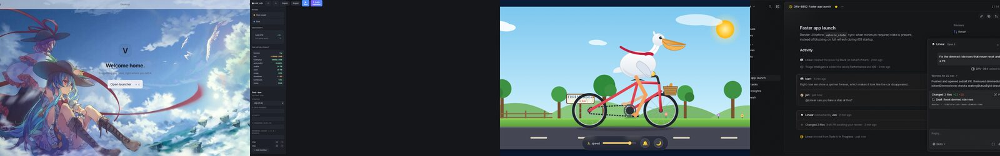

# Auto Dead Serious 🧱

English | [简体中文](README.zh-CN.md)

> A serious, inspectable home for weird software ideas: independent projects,
> pinned together without flattening their histories.

**For:** someone deciding whether the author can build a thing — a collaborator, a hiring reader, an engineer who wants the source rather than a pitch.
**Not for:** a package registry, a monorepo with one build, or a promise that any of this is production-supported. Each child owns its own toolchain, licence, tests and release path.

[](docs/result/catalogue-redesign/README.md)
[](LICENSE)
[](AGENTS.md)



*Left to right: VibeOS, Raid Calc, Pelican Bike, AutoFE — crops of screenshots committed to those repositories, not renders made for this page.*

## The collection, ranked

<!-- BEGIN GENERATED SHOWCASE -->
| Project | What it is | State | Showcase | Idea | Realized | Upside | Delivery |
|---|---|---|---:|---:|---:|---:|---:|
| [helpagent](docs/result/catalogue-redesign/README.md#helpagent) | A completed research campaign and harness measuring a fixed small local model in bounded… | delivered-once | 7.6 | 7.7 | 7 | 7.2 | 9 |
| [auto_maintain_bench](docs/result/catalogue-redesign/README.md#auto-maintain-bench) | A benchmark for small language models diagnosing and maintaining Linux hosts through constrained bash… | working | 6.8 | 7.0 | 6 | 6.4 | 8 |
| [agentic-animation](docs/result/catalogue-redesign/README.md#agentic-animation) | A local, project-agnostic pipeline for structured-story input, code-driven 2D puppet motion, replaceable… | working | 6.8 | 6.3 | 7 | 6.0 | 7 |
| [murderMysteryGame](docs/result/catalogue-redesign/README.md#murdermysterygame) | 《寿宴》 is a printable six-player-and-host mystery-game POC with role booklets, host instructions, clue cards,… | delivered-once | 6.5 | 7.0 | 6 | 5.2 | 7 |
| [fat_kakeya_needle](docs/result/catalogue-redesign/README.md#fat-kakeya-needle) | A mathematical and computational research workbench on minimizing the swept area of a 1×ε rectangle during a… | prototype | 6.3 | 7.3 | 5 | 5.6 | 6 |
| [raid_calc](docs/result/catalogue-redesign/README.md#raid-calc) | Offline browser calculator for expected data loss over time in arbitrarily nested storage pools, with a CTMC… | delivered-once | 5.9 | 6.0 | 6 | 4.5 | 8 |
| [aps](docs/result/catalogue-redesign/README.md#aps) | An experimental local planning workbench that models manufacturing item flows, compiles constraints,… | prototype | 5.8 | 5.3 | 6 | 5.2 | 7 |
| [dojo](docs/result/catalogue-redesign/README.md#dojo) | A local CLI and SQLite proof of concept for storing revisable, sourced discussion candidates, alternatives,… | prototype | 5.8 | 6.3 | 5 | 4.9 | 6 |

**70 historically assessed projects**: 5 working · 33 prototype · 1 design-only · 18 delivered-once · 9 archive · 4 private. 52 rows are still a first-pass estimate.

All 70 assessed projects, each with what you actually see, how every number was reached, what stays unverified and how the rating moved: [**open the gallery**](docs/result/catalogue-redesign/README.md). Scores are ordinal 0–10 judgement estimates from written evidence, not measurements, and the scale is defined there.

<!-- Generated by scripts/catalogue_final.py from assessments.json. Edit the ratings, not this block. -->
<!-- END GENERATED SHOWCASE -->

## Quickstart

See [Projects](PROJECTS.md) for current status, accepted deliveries and the queue. [Workspace](WORKSPACE.md) covers existing checkouts and acceptance.

```sh
git clone https://github.com/ZisIsNotZis/auto-dead-serious.git vibe
cd vibe
git submodule update --init --depth 1 --jobs 5 -- ygoDocGen monoploy11 monopoly12 learn_draw dojo
```

Ratings refer to their recorded historical revisions. Regenerate the tables with `python3 scripts/catalogue_final.py`.

## Status and limits

- **Every score on this page is an ordinal 0–10 judgement estimate from written evidence.** No build, test, render or model run backs any of them; none of the numbers is a measurement.
- **52 of the 70 rows have not been audited.** They keep a first-pass estimate; only audited rows say so in their trajectory.
- The published catalogue gives each project what a visitor actually sees, how each axis was reached, what stays unverified, and how its rating moved — [open it](docs/result/catalogue-redesign/README.md).
- Media on this page is a crop of a file already committed in a child repository, captioned with its source. Nothing was rendered, staged or edited for this page.
- Optional checkout notes live in [WORKSPACE.md](WORKSPACE.md); [agent-policy](https://github.com/ZisIsNotZis/agent-policy) is the historical policy now incorporated into Praxis and Praxis2.

## What “serious” means here

- **Reproducible:** version, changelog, commands and dated evidence — [an example](fat_kakeya_needle/) that keeps its certificates next to its claims.
- **Readable:** a compact README that says what the thing is and is not, before any feature list.
- **Visible:** screenshots, recordings and demo packages where they exist, instead of adjectives.
- **Maintainable:** issues and PRs are welcome, and agents can help while humans review and merge.

## Scope and non-goals

This is an index and a release boundary, not a monorepo, a shared build system, or a claim that every experiment is production-ready. Generated dependencies, credentials, private material and unreviewed media do not belong here.

## Future vision 🛰️

The collection should become a coherent catalogue of working ideas: every useful project can be tried in minutes, every innovation has measurable evidence, and every mature app has a release users can install. Projects keep their own documentation and release path; the roadmap is driven by the next meaningful project rather than a fixed inventory.

## Contributing

Open an issue or PR against the relevant child repository, or against this index for membership and the catalogue; the policy itself takes issues in [agent-policy](https://github.com/ZisIsNotZis/agent-policy). Include the affected path, evidence, and verification command. Agents may assist with triage, research, tests, docs, and implementation; maintainers review and merge.

## License

This aggregator's original materials are AGPL-3.0-only, and the policy in `agent-policy/` is MIT. Child repositories retain their own licenses; inspect each child before reuse.
